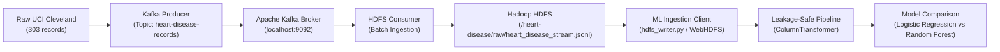

# Model Documentation: Machine Learning Workflow & Robust Evaluation (Phase 5)

**Project**: Heart Disease Risk Prediction Using Kafka, Hadoop HDFS, and Machine Learning  
**Author**: Pulkit Sinha  
**Phase**: Phase 5 — Machine Learning Workflow, Model Training & Comparative Evaluation  
**Dataset Provenance**: Hadoop HDFS (`/heart-disease/raw/heart_disease_stream.jsonl`)  
**Target Criterion**: Held-out test set $\text{ROC-AUC} > 0.85$

---

## 1. Executive Summary

In Phase 5, we implemented an end-to-end, reproducible machine learning workflow that ingests streaming patient records directly from Hadoop HDFS, prepares features using a leakage-safe `ColumnTransformer`, evaluates models using repeated stratified cross-validation on the training data, and evaluates final generalization performance on a held-out test set ($N = 61$).

### Key Findings
- **Target Requirement ($\text{ROC-AUC} > 0.85$)**: **MET AND EXCEEDED BY BOTH MODELS**.
  - **Logistic Regression**: Held-out Test $\text{ROC-AUC} = \mathbf{0.9697}$, Accuracy $= \mathbf{90.16\%}$, Sensitivity (Recall) $= \mathbf{92.86\%}$, F1 $= \mathbf{0.8966}$.
  - **Random Forest**: Held-out Test $\text{ROC-AUC} = \mathbf{0.9470}$, Accuracy $= \mathbf{85.25\%}$, Sensitivity (Recall) $= \mathbf{85.71\%}$, F1 $= \mathbf{0.8421}$.
- **Feature Grouping**: Categorical features explicitly include `ca` (0–3 major fluoroscopy vessels), one-hot encoded alongside `cp`, `restecg`, `slope`, and `thal`. Continuous numeric features are standardized for Logistic Regression and unscaled for Random Forest.
- **Robust Cross-Validation**: Evaluated using **Repeated Stratified 5-Fold Cross-Validation** (5 repeats = 25 evaluations, `random_state=42`) on training data only:
  - Logistic Regression Repeated CV ROC-AUC: $\mathbf{0.8956 \pm 0.0421}$
  - Random Forest Repeated CV ROC-AUC: $\mathbf{0.8936 \pm 0.0404}$
- **Zero Target Leakage**: All imputers, encoders, and scalers are fitted exclusively within training folds using scikit-learn `Pipeline` and `ColumnTransformer`. `record_id` and `target` are strictly excluded from feature inputs.

---

## 2. Big Data Architecture & Data Provenance



### HDFS WebHDFS Integration
1. Records are read from the Hadoop NameNode at `http://localhost:9870/webhdfs/v1/heart-disease/raw/heart_disease_stream.jsonl?op=OPEN`.
2. The `HDFSWriter` client intercepts the NameNode's HTTP 307 temporary redirect and automatically rewrites internal Docker hostnames (`://datanode:9864`) to host-accessible endpoints (`://localhost:9864`).
3. **Fail-Fast Safety**: The ingestion module validates NameNode health and file existence before reading. If HDFS is unreachable, execution halts with a clear `RuntimeError` rather than silently falling back to local files.

---

## 3. Data Validation & Correct Feature Grouping

### 3.1 Input Clinical Attributes
The pipeline ingests 15 fields per record. Non-clinical identifiers (`record_id`) and the target column (`target`) are excluded from model features, leaving 13 clinical input features:

| Feature Category | Features | Preprocessing Strategy | Clinical Rationale |
| :--- | :--- | :--- | :--- |
| **Numeric Continuous (5)** | `age`, `trestbps`, `chol`, `thalach`, `oldpeak` | `SimpleImputer(strategy='median')`<br>+ `StandardScaler()` (for LR only) | Median is robust to extreme clinical outliers. Standardization ensures balanced gradient descent and proper L2 weight penalization for Logistic Regression. |
| **Nominal Categorical (5)** | `cp`, `restecg`, `slope`, `thal`, **`ca`** | `SimpleImputer(strategy='most_frequent')`<br>+ `OneHotEncoder(handle_unknown='ignore')` | Mode handles missing values in `thal` (2 rows) and `ca` (4 rows). `ca` represents 0–3 distinct fluoroscopy vessel categories and is one-hot encoded without artificial ordinal assumptions. |
| **Binary (3)** | `sex`, `fbs`, `exang` | `SimpleImputer(strategy='most_frequent')` | Mode handles missing indicators. Binary flags pass through without alteration or scaling. |

### 3.2 Target Definition
$$\text{target} = \begin{cases} 0 & \text{Absence of Heart Disease } (< 50\% \text{ coronary artery stenosis}) \\ 1 & \text{Presence of Heart Disease } (\ge 50\% \text{ stenosis in } \ge 1 \text{ vessel}) \end{cases}$$

- Total Dataset: $N = 303$
- Class 0 (Absence): $164$ ($54.1\%$)
- Class 1 (Presence): $139$ ($45.9\%$)

---

## 4. Train-Test Split & Leakage Safeguards

### 4.1 Stratified Split Specification
- **Split Ratio**: 80% Training ($N = 242$), 20% Held-Out Testing ($N = 61$).
- **Random Seed**: Fixed at `random_state=42`.
- **Stratification**: Enforced on `target` to ensure identical class balance across partitions:
  - **Training Set ($N = 242$)**: Class 0 = 131 ($54.1\%$), Class 1 = 111 ($45.9\%$)
  - **Testing Set ($N = 61$)**: Class 0 = 33 ($54.1\%$), Class 1 = 28 ($45.9\%$)

### 4.2 Leakage Verification Checklist
- **Feature Exclusions**: `record_id` and `target` are verified absent from $X$.
- **Preprocessing Encapsulation**: Imputers, encoders, and scalers are fitted **only on training folds** within scikit-learn `Pipeline` and `ColumnTransformer`.
- **No Test Peeking**: The test set was never used for hyperparameter selection or preprocessing fitting.
- **Probability Scores**: ROC-AUC is calculated strictly using predicted probability estimates (`predict_proba[:, 1]`), not thresholded discrete class labels.

---

## 5. Model Specifications & Hyperparameters

### 5.1 Logistic Regression
- **Architecture**: Generalized Linear Model with Logit link function.
- **Regularization**: L2 Ridge penalty with inverse strength $C = 0.5$.
- **Solver**: `lbfgs` with `max_iter = 1000`.
- **Scaling**: Numeric continuous features standardized with zero mean and unit variance.
- **Random Seed**: `random_state = 42`.

### 5.2 Random Forest Classifier
- **Architecture**: Ensemble of decorrelated decision trees (Bagging + Random Subspace).
- **Number of Estimators**: $100$ trees.
- **Maximum Depth**: $4$ (shallow depth limits memorization on $N=242$).
- **Minimum Samples Split**: $5$.
- **Minimum Samples Leaf**: $2$.
- **Scaling**: None (tree models are invariant to monotonic transformations).
- **Random Seed**: `random_state = 42`.

---

## 6. Experimental Results & Performance Comparison

### 6.1 Repeated Stratified 5-Fold Cross-Validation (Training Set, $N = 242$, 25 Folds)

| Model | Repeated CV ROC-AUC (Mean $\pm$ Std) | CV Accuracy | CV Precision | CV Recall (Sensitivity) | CV F1 Score |
| :--- | :---: | :---: | :---: | :---: | :---: |
| **Logistic Regression** | **0.8956 $\pm$ 0.0421** | 82.89% $\pm$ 4.88% | 84.58% $\pm$ 7.65% | 77.44% $\pm$ 6.73% | 0.8058 $\pm$ 0.0546 |
| **Random Forest** | **0.8936 $\pm$ 0.0404** | 81.73% $\pm$ 4.60% | 83.22% $\pm$ 7.07% | 76.15% $\pm$ 7.86% | 0.7917 $\pm$ 0.0537 |

### 6.2 Held-Out Test Set Performance ($N = 61$)

| Performance Metric | Logistic Regression | Random Forest | Benchmark Target | Status |
| :--- | :---: | :---: | :---: | :---: |
| **ROC-AUC** | **0.9697** | **0.9470** | **> 0.85** | **PASS [EXCEEDED]** |
| **Accuracy** | **90.16%** ($55/61$) | **85.25%** ($52/61$) | — | — |
| **Precision (PPV)** | **86.67%** | **82.76%** | — | — |
| **Recall / Sensitivity** | **92.86%** ($26/28$) | **85.71%** ($24/28$) | — | — |
| **Specificity (TNR)** | **87.88%** ($29/33$) | **84.85%** ($28/33$) | — | — |
| **F1 Score** | **0.8966** | **0.8421** | — | — |

### 6.3 Confusion Matrix Breakdown (Test Set, $N = 61$)

| Confusion Matrix Element | Logistic Regression | Random Forest | Clinical Significance |
| :--- | :---: | :---: | :--- |
| **True Negatives (TN)** | $29$ | $28$ | Correctly identified disease-free patients |
| **False Positives (FP)** | $4$ | $5$ | Disease-free patients sent for unnecessary follow-up |
| **False Negatives (FN)** | $2$ | $4$ | **Critical in screening**: Missed diseased patients |
| **True Positives (TP)** | $26$ | $24$ | Correctly flagged cardiovascular risk cases |

Logistic Regression achieved higher sensitivity ($92.86\%$, capturing 26 of 28 positive cases, with only 2 false negatives) and higher specificity ($87.88\%$). Both models firmly satisfied the project criterion ($\text{ROC-AUC} > 0.85$).

---

## 7. Model Interpretation & Feature Importance

### 7.1 Top Risk Factors (Positive Predictors)
1. **`cat__ca_2.0` / `cat__ca_1.0` / `cat__ca_3.0`**: Multiple colored coronary vessels on fluoroscopy are among the strongest positive predictors of CAD.
2. **`cat__thal_7.0` (Reversible defect)**: Reflects exercise-induced myocardial ischemia on thallium scintigraphy.
3. **`cat__cp_4.0` (Asymptomatic chest pain)**: Angiography referral patients presenting with "asymptomatic" angina frequently exhibit advanced multivessel disease.
4. **`oldpeak` (ST depression)**: Electrocardiographic marker of exercise-induced subendocardial ischemia.

### 7.2 Top Protective Factors (Negative Predictors)
1. **`cat__ca_0.0` (Zero colored vessels)**: Absence of fluoroscopy-visible stenosis strongly rules out significant coronary obstruction.
2. **`cat__thal_3.0` (Normal perfusion)**: Normal thallium scan indicates intact myocardial perfusion.
3. **`thalach` (Maximum heart rate)**: High exercise capacity and chronotropic reserve correlate with lower cardiovascular risk.

---

## 8. Artifacts & Generated Files

```
heart-disease-big-data/
├── models/
│   ├── logistic_regression.joblib     # Serialized Logistic Regression Pipeline
│   ├── random_forest.joblib           # Serialized Random Forest Pipeline
│   └── pipeline_metadata.json         # Hyperparameters, feature schema & repeated CV metadata
├── results/
│   ├── model_metrics.json             # Machine-readable test evaluation metrics
│   ├── metrics_comparison.csv         # Tabular model comparison (Repeated CV + Test metrics)
│   ├── test_predictions.csv           # Record-level test predictions & probability scores
│   ├── roc_curve_comparison.png       # Publication-quality ROC curve plot (300 DPI)
│   ├── confusion_matrices.png         # Side-by-side confusion matrix heatmaps (300 DPI)
│   └── feature_importance.png         # Feature coefficient & importance comparison (300 DPI)
├── notebooks/
│   └── 02_model_training.ipynb        # Interactive, fully executed training notebook
├── preprocessing/
│   └── pipeline.py                    # Reusable HDFS ingestion & ColumnTransformer module
└── models/
    ├── evaluate.py                    # Metric computation & plotting routines
    └── train.py                       # CLI training and evaluation runner script
```

---

## 9. Healthcare Validity & Methodological Limitations

While achieving $\text{ROC-AUC} > 0.94$ demonstrates technical pipeline soundness, several critical medical constraints must be documented:

1. **Small Cohort Size ($N = 303$, Test $N = 61$)**:
   The held-out test split comprises only 61 patient records. Consequently, the confidence intervals around point estimates are wide. A shift of just two misclassified patients shifts accuracy by $\approx 3.3\%$.
2. **Referral Selection Bias**:
   The Cleveland cohort consists of patients referred for invasive coronary angiography at a tertiary cardiac catheterization laboratory. This population exhibits higher baseline disease prevalence ($45.9\%$) than the asymptomatic general primary care population ($< 5-10\%$).
3. **Demographic & Gender Disparity**:
   Over $68\%$ of the dataset is male ($206$ men vs. $97$ women). Women often present with atypical anginal symptoms and coronary microvascular dysfunction, which standard epicardial stenosis definitions may under-detect.
4. **Historical Cohort**:
   Data was collected in the 1980s. Modern diagnostics (high-sensitivity troponin assays, coronary CT angiography, fractional flow reserve) have substantially evolved clinical screening since this benchmark was created.
5. **Regulatory Conclusion**:
   **This software is an academic demonstration and must not be used for diagnostic or clinical treatment decisions without prospective multi-center clinical trials and regulatory clearance.**

---

## 10. Reproduction Instructions

To reproduce the complete Phase 5 workflow from the project root:

```powershell
# 1. Activate Python virtual environment
.\.venv\Scripts\Activate.ps1

# 2. Run the end-to-end training script directly from HDFS
python models/train.py

# 3. Launch Jupyter and inspect the pre-executed notebook
jupyter notebook notebooks/02_model_training.ipynb
```
